# Architecture

kiro-crew is a thin, modular layer over Strands Agents. Strands provides the agent loop, tool calling,
model providers, session management, memory plugin and model router. kiro-crew adds the product
pieces around them: channels, a gateway, config-driven agents, durable tasks and a plugin system.

Diagrams use [Mermaid](https://mermaid.js.org) (rendered by GitHub and most Markdown viewers).

## 1. Design principles

1. **Everything swappable sits behind a registry or a protocol.** Core code never imports a concrete
   provider, channel, or memory backend by name.
2. **One choke point.** All inbound traffic passes through the `Gateway`; all agent construction passes
   through the `AgentFactory`. Cross-cutting rules (auth, sessions, model choice, memory scope) live
   there and nowhere else.
3. **State is durable and boring.** One SQLite file holds sessions, memory and tasks. Any process can
   be restarted without losing a conversation or a running job.
4. **Config over code.** Crew composition, model choice, tools and channels come from YAML.
5. **Safe by default.** Deny-by-default allow-lists, sandboxed file access, signed webhooks.
6. **Lean on Strands.** Memory injection, extraction, summarising, session restore, tool hooks and model failover are
   Strands features, not reimplemented here.
7. **Fail closed.** Sandbox tools refuse rather than run on the host; unanswered approvals are denials; unaddressable
   approvals are refusals; unknown senders get nothing unless pairing is on.
8. **Degrade, don't die.** If embeddings or search backends fail, memory falls back to keyword search and tools report
   errors as text instead of aborting the turn.
9. **Observable, safely.** Every unit of work carries a turn id through `contextvars`; structured logs flow to
   console/file/JSON and a read-only dashboard. Message content is hidden and secrets are masked by default, so turning
   visibility up does not leak conversations or credentials.
10. **Persistence is a backend.** Sessions, tasks, schedules, pairing and settings sit behind protocols chosen by config,
    with one behavioural contract suite every backend must pass.
11. **Roles are data, trust is explicit.** An agent is configuration (a YAML entry or a dropped-in file), added or changed live
    and validated before it takes effect; what an agent may see of the owner is an explicit, per-agent setting that defaults to
    the old behaviour and flips with one switch (`isolated`).

## 2. System context

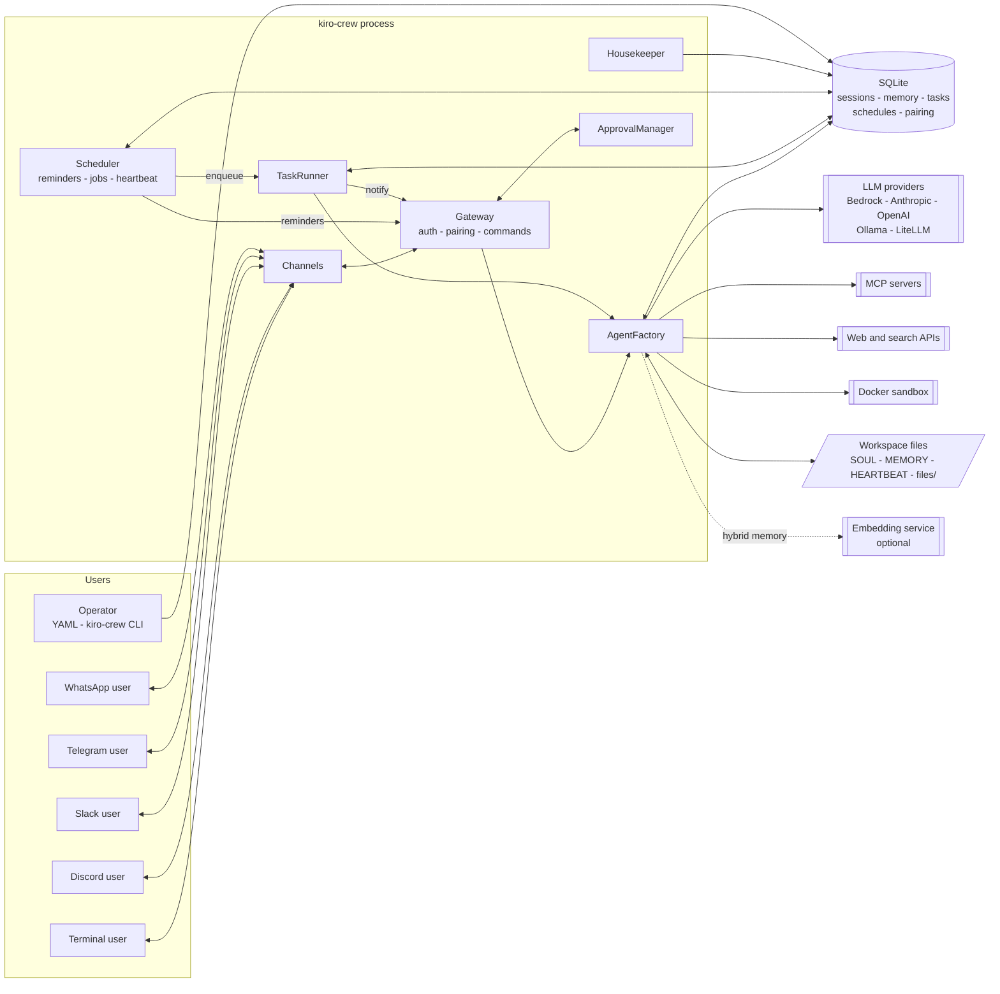

## 3. Component view

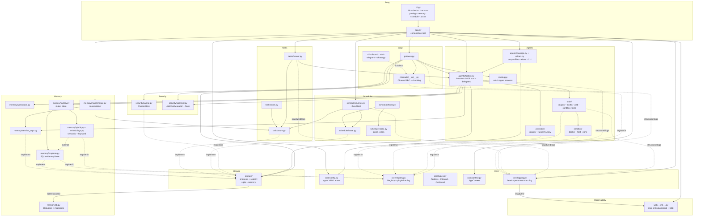

Dependency direction is strictly downward: channels know nothing about agents, agents know nothing
about channels. The only upward links are late-bound through `AppContext.services` (`agent_factory`,
`gateway`, `task_runner`) to avoid import cycles.

## 4. Message flow (chat turn)

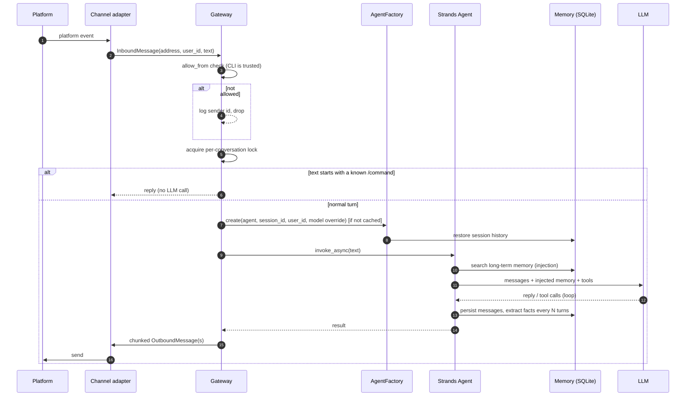

Turns within one conversation are serialised (a later message waits for the earlier one). Different
conversations run concurrently.

## 5. Agent assembly

`AgentFactory.create()` is the only place agents are built.

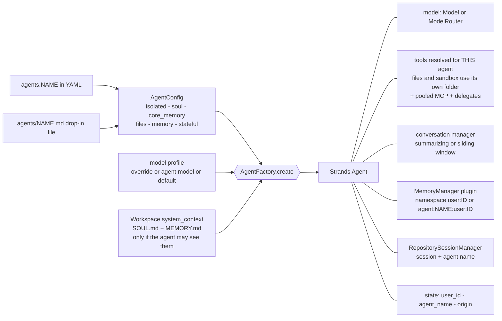

### Crew and delegation

Declaring `delegates: [researcher]` exposes the researcher to `main` as an `ask_researcher` tool. The
sub-agent is built fresh per call with no session and no memory writes, and runs to completion before
returning text to the caller. Depth is capped at 2.

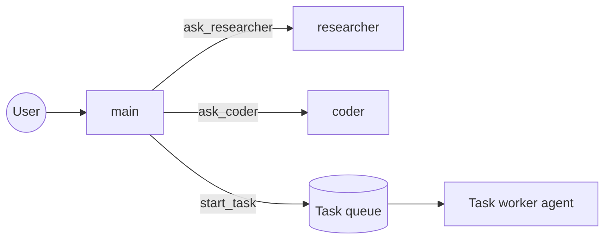

### Isolation, in one picture

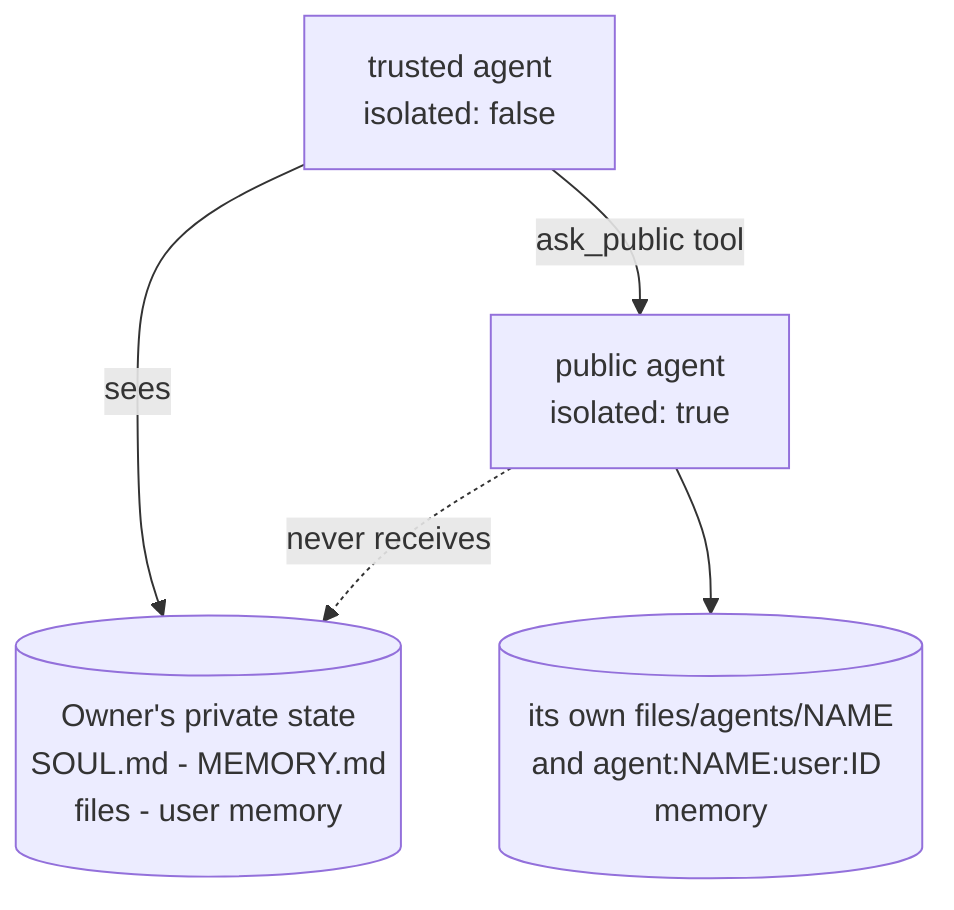

Isolation is decided by the **callee**: a trusted parent delegating to an isolated agent does not leak its context into it.
Delegates can be `stateful` (own persisted conversation, `<parent session>~<delegate>`) and share pooled MCP servers.

### Which agent answers, and live reload

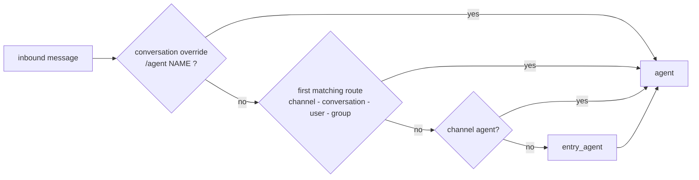

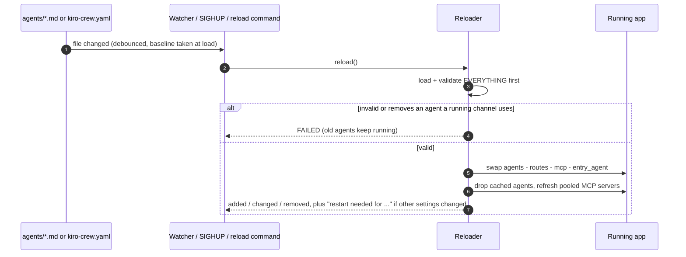

## 6. Memory architecture

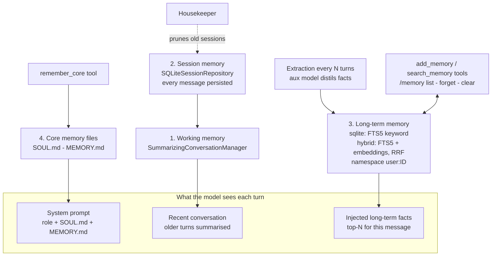

| Layer | Scope | Lifetime | Written by | Read by |
|---|---|---|---|---|
| Working | one conversation | context window | Strands | the model |
| Session | one conversation | until `/new` | Strands session manager | restores agent after restart |
| Long-term | one user (or shared) | permanent | extraction, `add_memory` | automatic injection, `search_memory` |
| Core files | whole workspace | permanent | you, `remember_core` | every system prompt |

Memory scope is decided in `Gateway._user_key`: `shared` (one bucket) or per sender, optionally linked
across channels through `identities`.

## 7. Background task lifecycle

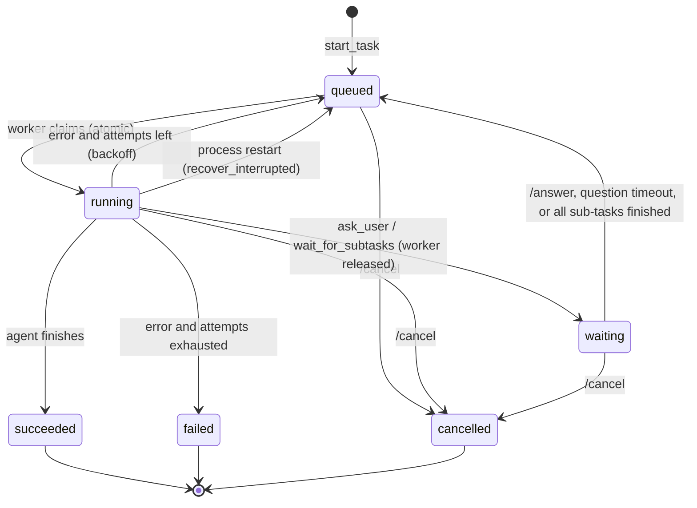

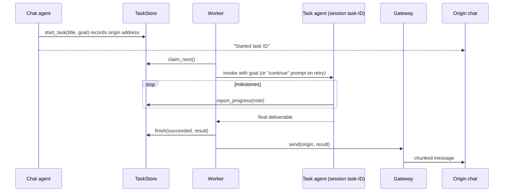

Resumability comes from giving each task its own persisted Strands session. On a retry or after a
restart the agent reloads its full history and is told to continue (or, after an error, what failed).

Around this loop sit the autonomy features of [spec 21](specs/21-autonomy.md): a verifier that checks the result against `done_when`
and sends the agent back, a plan + notes kept in the task row and re-injected into the system prompt before every model call,
`ask_user` and sub-tasks that park the task as `waiting` without holding a worker, and a budget hook (tool calls, repeated calls,
tokens) that steers first and stops second.

## 8. Scheduling and heartbeat

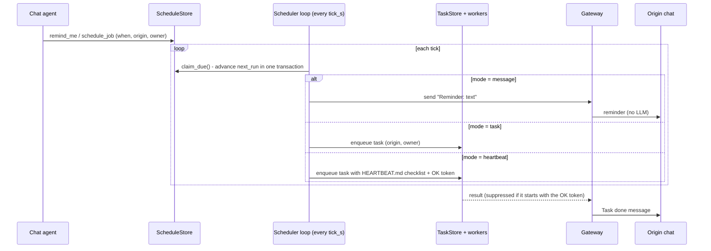

## 9. Access control flows

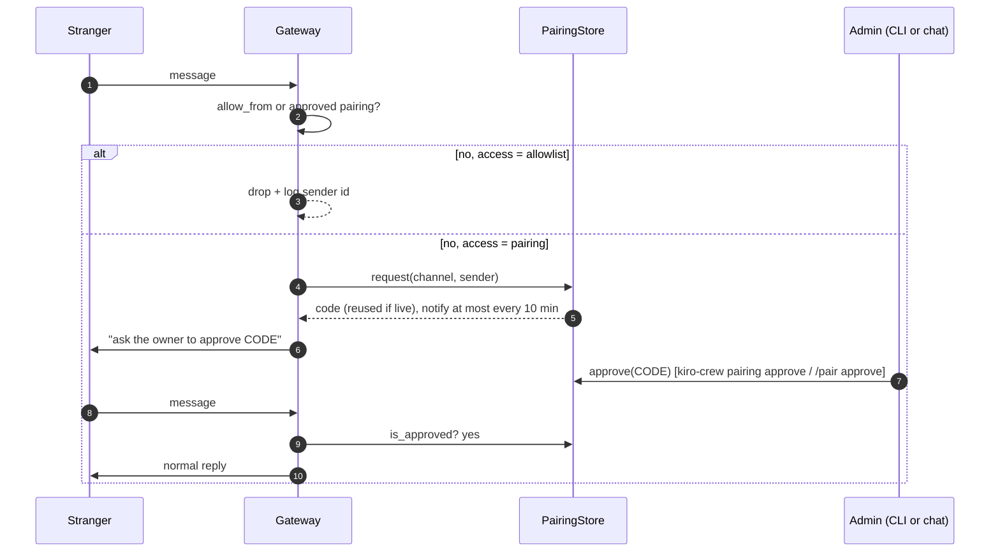

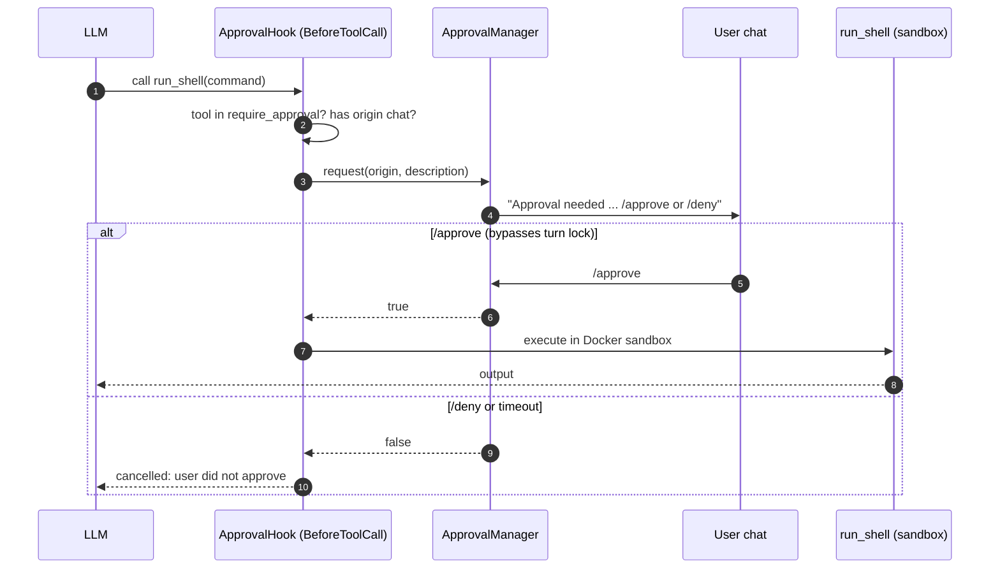

## 10. Extensibility model

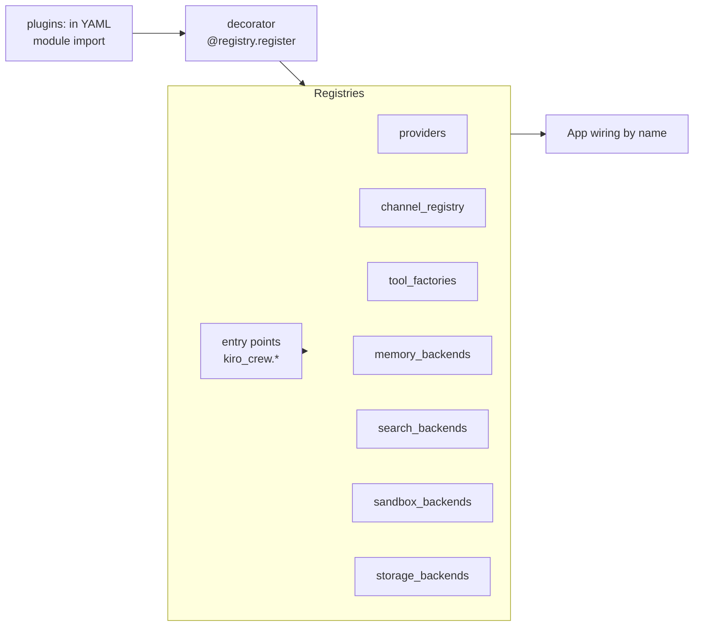

Lookup is by string name coming from YAML, so adding an implementation never touches core code.
Entry points load lazily on first lookup; a broken third-party plugin is logged and skipped.

## 11. Data model (SQLite, WAL)

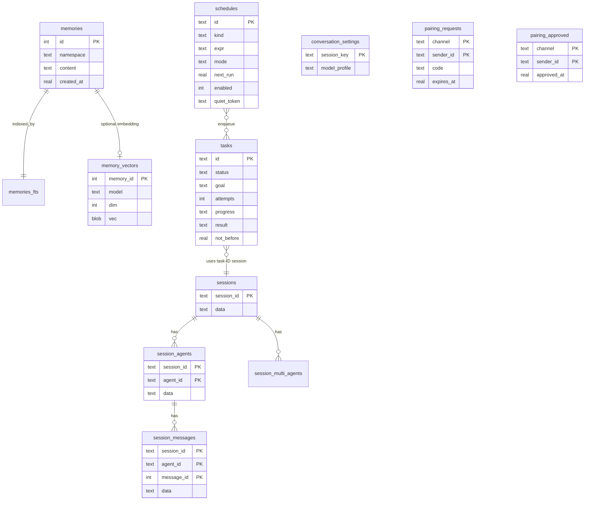

`memories` has `UNIQUE(namespace, content)` so at-least-once extraction writes are idempotent. This schema is the `sqlite` storage backend's; the `memory` backend holds the same entities in process. `memory_vectors` rows are
deleted with their memory (`ON DELETE CASCADE`). Columns added after v0.1 (`tasks.quiet_token`,
`session_messages.updated_at`) are added by in-place migrations on start (`Database.ensure_column`).

## 12. Concurrency and failure model

| Concern | Approach |
|---|---|
| Two messages in one conversation | per-conversation `asyncio.Lock` (weakly held, auto-freed) |
| Many conversations | concurrent; at most 64 agents cached (LRU), rebuilt from session on miss |
| Blocking SQLite from async code | single connection behind an `RLock`; operations are short |
| Task claimed twice | `claim_next` runs in `BEGIN IMMEDIATE` |
| Crash mid-task | status stays `running`; next start re-queues and resumes from the session |
| LLM error in a task | retry with backoff `min(30 * 2^(n-1), 600)` s up to `max_attempts` |
| Channel send failure for a task result | logged; the task result stays in the store |
| Graceful shutdown | stop workers (tasks remain `running`), stop channels, close DB |
| Bad third-party plugin | logged and skipped at entry-point load |
| Scheduler tick crash | logged; loop continues; one schedule failing does not block others |
| Schedule dispatched but process dies before completion | lease expires and the schedule is re-claimed (at-least-once); may fire twice |
| Approval nobody answers | auto-denied after `approval_timeout_s`; the turn continues |
| Embedding service down | facts still saved; search falls back to keyword; `reindex` heals |
| Docker missing | sandbox tools return an error; never run on the host |
| Channel built before the event loop exists | adapters create loop-bound objects in `start()` (a Slack bug of this kind was caught by tests) |
| Log emitted from a worker thread | ring buffer marshals fan-out onto the loop (`call_soon_threadsafe`) |
| Slow web-dashboard viewer | its per-subscriber queue drops events rather than blocking logging |
| Field name collides with a LogRecord attribute | renamed with an `f_` prefix instead of raising |

## 13. Security model

| Threat | Mitigation |
|---|---|
| Strangers using the bot | `allow_from` deny-by-default; sender id logged for onboarding |
| Group chat noise or abuse | Discord, Telegram: reply only when mentioned; Slack: thread replies |
| Agent file access | `files` tool resolves paths inside `workspace/files`; escape raises `PermissionError` |
| Forged WhatsApp webhooks | HMAC-SHA256 of the raw body (`X-Hub-Signature-256`), constant-time compare; verify token |
| Duplicate/retried webhooks | message-id de-duplication window (2000 ids) |
| Secrets in config | `${ENV}` expansion; `kiro-crew.yaml` is git-ignored |
| Cross-user memory leaks | memory namespace per user (or explicit `shared`) |
| FTS query injection | search terms are tokenised and individually quoted |
| Runaway delegation | depth cap of 2; task agents cannot start tasks or schedules |
| Stranger enumeration / flooding in pairing mode | random one-time codes, 1 h expiry, pending queue capped at 20, replies rate-limited |
| Dangerous tool calls | `require_approval` pauses the call until the user types `/approve`; unanswered = denied; no chat = refused |
| Agent-run code harming the host | Docker sandbox: no network, no capabilities, read-only root, resource limits, only `files/` mounted; fails closed without Docker |
| SSRF through `web_fetch` | public addresses only, every redirect hop re-validated, size/time caps; content labelled untrusted |
| Unbounded growth of stored data | retention housekeeping for sessions and finished tasks |

Not covered: robust prompt-injection defence (web content is labelled untrusted and risky tools can require approval, but
neither is a guarantee), per-user rate limiting and budgets, and sandboxing of third-party tools, vended Strands
`shell`/`python_repl`, or MCP servers. (`web_fetch` now pins the connection to the vetted IP, closing the
DNS-rebinding window; still restrict the process's egress as defence in depth.) Treat enabled tools as having the agent's full
authority.

## 14. Key decisions

| Decision | Why | Trade-off |
|---|---|---|
| SQLite as the default storage backend | zero ops, durable, one file to back up | single node (but storage is now behind a registry, so a networked backend can replace it) |
| stdlib `sqlite3` + lock, not an async driver | Strands calls session repositories synchronously | brief event-loop blocking |
| Persistence behind five small protocols as a `Storage` bundle | swap the whole backend by config; one contract suite guards every backend | more indirection than direct SQL |
| Logs hide content and mask secrets by default | the dashboard/logging are safe to enable without leaking chats or keys | pattern-based scrubbing is best-effort |
| Keyword (FTS5) long-term search | no embedding model or service needed to start | weaker paraphrase recall |
| Strands `MemoryManager` | injection, extraction and tools are already solved | tied to its API |
| Agents-as-tools for the crew | simple, observable, no graph engine | sub-agents are one-shot and stateless |
| Per-task sessions | free crash-resume and isolated context | one extra session per task |
| Lazy channel imports | optional dependencies only needed when enabled | adapter errors surface at startup |
| Rebuild agent on `/model` | session restore makes it cheap and always correct | one-turn rebuild cost |
| Scheduler reuses the task queue | one execution path (retries, timeouts, resume, notifications) | scheduled work inherits task limits |
| Reminders bypass the LLM | cheap and reliable | no dynamic content in the reminder |
| Lease-then-complete scheduling | at-least-once: a crash never drops a firing | a crash after dispatch can fire twice |
| Hybrid memory = SQLite + in-process vectors | no extra service; graceful degradation | scan cost grows with facts per user |
| Approval via the same chat (hook + turn-lock bypass) | no separate UI needed | one prompt at a time per conversation |
| Docker for sandboxing, fail closed | strong, well-understood isolation | needs Docker; no silent fallback by design |
| Agent isolation decided by the callee, opt-in per agent | no surprise for existing setups; one switch for public-facing agents; correct under delegation and tasks | trusted agents can still read isolated agents' folders; isolation is not a tool sandbox |
| Drop-in markdown agents + `delegate_of` | adding a role needs no YAML surgery or restart; the parent need not be edited | a writable `agents/` folder is a control surface (protect it like the config) |
| Reload applies agents/routes/MCP only, validated first | a typo cannot break a live bot; risky settings stay restart-only | channel/model changes still need a restart |
| `selectable` defaults to false | switching changes whose tools answer the user, so it must be a deliberate grant | an extra setting to enable user choice |
| Pooled MCP clients with a permanent pin | one server process for many short-lived agents (measured 5 spawns -> 1) | servers live until shutdown or config change |
| Pairing as an opt-in per channel | easy onboarding without YAML edits | replies to strangers |
| Per-turn context via contextvars | one `turn_id` correlates logs across gateway/agent/tools/tasks without threading an arg everywhere | lost if work hops threads without copying context |
| In-memory ring buffer + SSE for the UI | zero deps, live streaming, no log DB | history bounded by capacity; single-node |
| Web dashboard read-only + token | visibility without a mutation attack surface | actions still go through chat/CLI |
